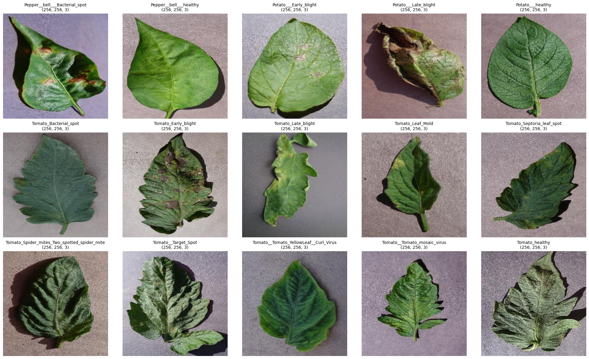
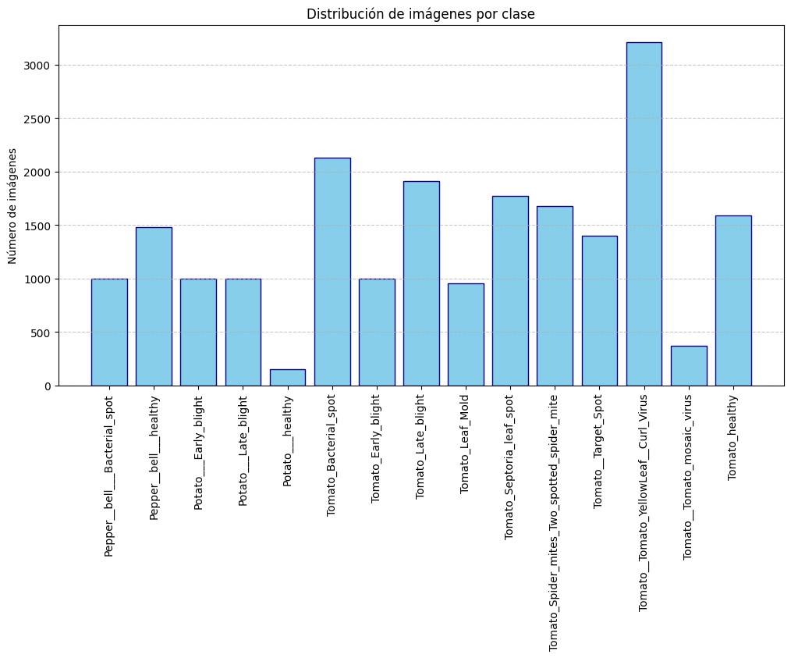
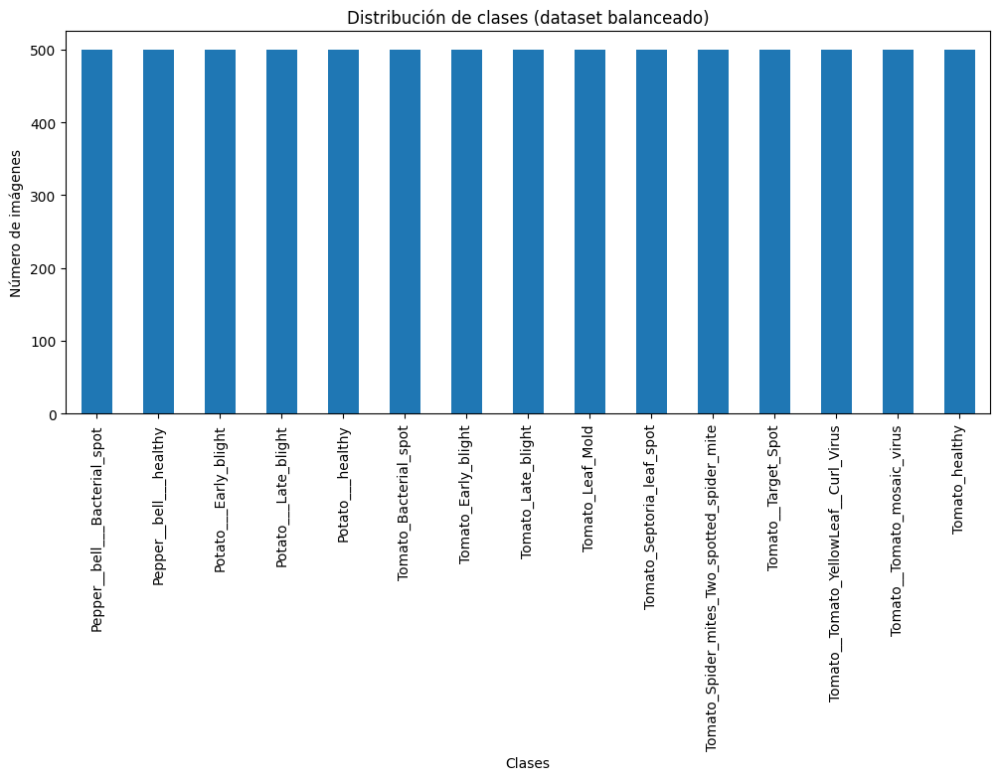
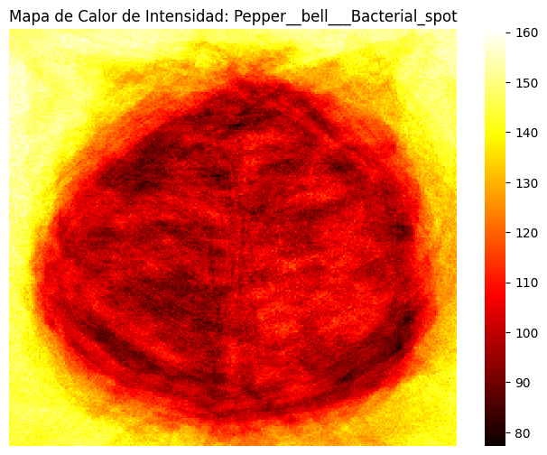
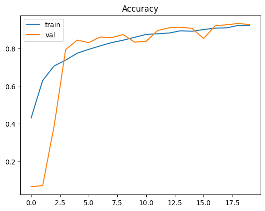
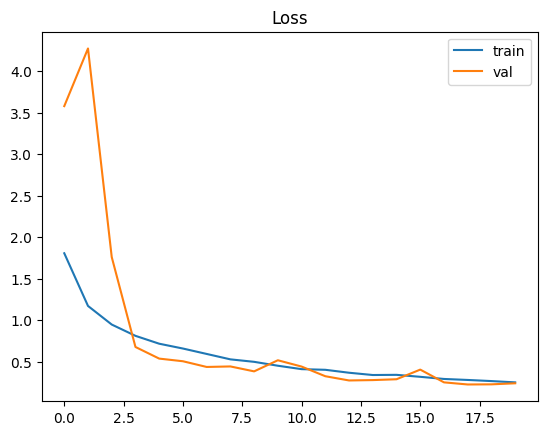
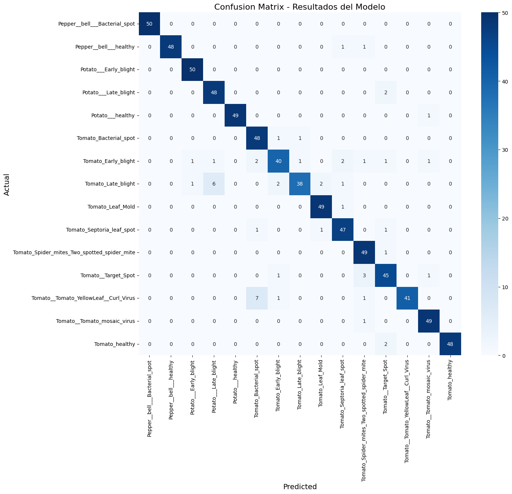

# Plant Disease Classification

An image classification project exploring convolutional neural networks and transfer learning to distinguish healthy leaves from common plant diseases across 15 PlantVillage classes. The project covers dataset exploration, class balancing, image preprocessing, model training, and evaluation.

## Tech Stack

- **Deep learning:** TensorFlow, Keras
- **Data analysis:** Python, NumPy, pandas, scikit-learn
- **Image processing:** OpenCV
- **Visualization:** Matplotlib, Seaborn
- **Notebook environment:** Google Colab, Jupyter

## Dataset

The experiments use 15 PlantVillage classes across pepper, potato, and tomato leaves, covering both healthy and diseased plants.

- **Source:** [PlantVillage dataset on Kaggle](https://www.kaggle.com/datasets/emmarex/plantdisease)
- **Original project:** [PlantVillage-Dataset](https://github.com/spMohanty/PlantVillage-Dataset)

The image dataset and generated intermediate files are not included in this repository. Please refer to the source dataset and the notebooks for the data preparation workflow. Check the source page for its current terms before reusing or redistributing the data.





## Methodology

- **Exploratory analysis:** Inspect the 15 classes, their image counts, sample leaves, image dimensions, and spatial intensity heatmaps. The heatmaps were used as a visual aid when considering the model input size.
- **Image preparation:** Resize source images from 256 × 256 to 224 × 224 pixels for model input, and apply the normalization or preprocessing required by each experiment.
- **Original-data baseline:** Use a stratified 80/10/10 train/validation/test split and class weights to account for the original class imbalance.
- **Balanced-data experiments:** Cap classes with more than 500 images at 500, augment classes with fewer images to reach 500, then create a stratified 80/10/10 split.
- **Models and evaluation:** Experiment with a custom CNN, DenseNet121, and EfficientNetB0, evaluating accuracy and per-class precision, recall, and F1-score.





## Results

The table summarizes the metrics recorded in the notebooks. These experiments use different dataset preparation and training configurations, so the scores should not be interpreted as a controlled head-to-head comparison.

| Experiment | Model | Dataset and evaluation setup | Test images | Accuracy | Macro F1 |
|---|---|---|---:|---:|---:|
| Original-data baseline | CNN | Original class distribution; class weights; stratified 80/10/10 split | 2,064 | 89.68% | 0.88 |
| Original-data baseline | DenseNet121 | Original class distribution; class weights; stratified 80/10/10 split | 2,064 | 92.64% | 0.92 |
| Balanced-data experiment | CNN | 500 images/class after sampling and augmentation; stratified 80/10/10 split | 750 | 86.13% | 0.86 |
| Balanced-data experiment | DenseNet121 | 500 images/class after sampling and augmentation; stratified 80/10/10 split | 750 | 93.33% | 0.93 |
| Balanced-data experiment | EfficientNetB0 (frozen base) | 500 images/class; transfer learning; stratified 80/10/10 split | 750 | 95.20% | 0.95 |
| Balanced-data experiment | EfficientNetB0 (fine-tuned) | 500 images/class; final 50 base layers unfrozen; stratified 80/10/10 split | 750 | 98.13% | 0.98 |
| Proposed-model experiment | Proposed CNN | Balanced 500/class dataset; stratified 80/10/10 split | 750 | 93.20% | 0.93 |
| Additional comparison | EfficientNetB0 | Balanced 500/class dataset; separate notebook experiment | 750 | 95.47% | — |

For the balanced-data experiments, class balancing and image augmentation were performed before the stratified train/validation/test split. These results reflect that experiment setup. Per-class precision, recall, and F1-score reports are available in the corresponding notebooks.

### Proposed CNN







## Notebooks

| Notebook | Purpose |
|---|---|
| [`01_plantvillage_dataset_exploration.ipynb`](notebooks/01_plantvillage_dataset_exploration.ipynb) | Explore the dataset, class distribution, sample images, image dimensions, and spatial intensity heatmaps. |
| [`02_cnn_and_densenet_baselines.ipynb`](notebooks/02_cnn_and_densenet_baselines.ipynb) | Train CNN and DenseNet121 baselines on the original class distribution using class weights. This experiment is independent of the balanced-data workflow. |
| [`03_balanced_dataset_cnn_experiment.ipynb`](notebooks/03_balanced_dataset_cnn_experiment.ipynb) | Limit larger classes to 500 images, augment smaller classes to 500, and run CNN, DenseNet121, and EfficientNetB0 experiments. An export cell saves `ndf_final.csv` and augmented images for notebook 04. |
| [`04_cnn_vs_efficientnet_experiments.ipynb`](notebooks/04_cnn_vs_efficientnet_experiments.ipynb) | Run the proposed CNN and EfficientNetB0 experiments using the balanced-data artifacts exported by notebook 03. |

To reproduce the balanced-data comparison, run notebook 03 first, including its artifact-export cell, and then run notebook 04. Notebook 02 is a separate baseline experiment.

## Setup and Reproducibility

The notebooks were developed for Google Colab. They mount Google Drive and use the `PROJECT_DIR` variable to locate the dataset and generated files.

1. Open the notebooks in Google Colab and set `PROJECT_DIR` to a folder in your Google Drive.
2. Place the PlantVillage data under `PROJECT_DIR/PlantVillage`, or use the download cell in notebook 01. Downloading from Kaggle requires Kaggle API credentials configured in Colab.
3. Run notebook 02 independently for the original-data baselines.
4. For the balanced-data experiments, run notebook 03 in order, including its export cell. It creates `ndf_final.csv` and the `aug/` folder used by notebook 04.
5. Run notebook 04 after those artifacts have been created.

The package versions used for the experiments are listed in [`requirements.txt`](requirements.txt). Google Colab provides its Drive integration; it is not a pip package in that file.

## Project Structure

```text
plant-disease-classification/
├── images/       # Selected figures used in the README
├── notebooks/    # Dataset exploration and model experiments
├── .gitignore
├── README.md
└── requirements.txt
```

## 👋 About Me

**Leonardo Yeret Ortiz Valle**  
Systems Engineering Student | Artificial Intelligence Specialist

[💻 GitHub](https://github.com/LeoOrtizV) · [🔗 LinkedIn](https://www.linkedin.com/in/leonardo-yeret-ortiz-valle-092346345/)